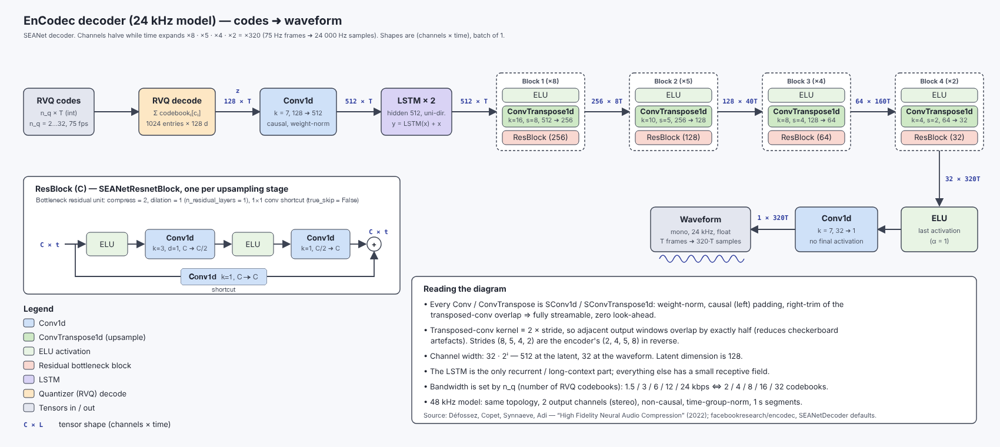

# FLMSBMP Meta's EnCodec Decoder — by Wavebits

**F**astest · **L**owest **M**emory · **S**mallest **B**inary · **M**ost **P**ortable



**FLMSBMP is a decoder for Meta's [EnCodec](https://github.com/facebookresearch/encodec)
audio codec, made to be embedded in phones and other small devices.** EnCodec compresses
speech and music to as little as 1.5 kbps, but turning the codes back into sound normally
takes Python with PyTorch, or [encodec.cpp](https://github.com/PABannier/encodec.cpp) with
ggml. FLMSBMP does the same job in two plain C files that need nothing beyond libc and
threads, in memory that doesn't grow with the length of the audio. A second implementation
in Zig gives the same output, so the two can be compared and the faster or smaller
approach kept. The command-line tools are `wb_decode-c` and `wb_decode-zig`. The diagram
above shows the decoder; [docs/architecture.md](docs/architecture.md) explains it layer by
layer.

## Benchmark at a glance

Decoding 30 s of 6 kbps audio on an Apple M1 with 4 threads (median of 5 runs):

| | FLMSBMP (C) | encodec.cpp | PyTorch `encodec` |
| --- | --- | --- | --- |
| 📦 Size to ship | **72 KB** | 905 KB | 518 MB + Python |
| 🧠 Peak memory | **77 MB** | 1.09 GB | 2.17 GB |
| ⚡ Time | **0.45 s** | 2.97 s | 1.79 s |
| 🔌 Dependencies | **libc** (+ Accelerate on Apple) | ggml + C++ runtime | Python + PyTorch |

- **Fastest:** 4× faster than PyTorch and 6.6× faster than encodec.cpp. Counting only the
  decoding, without startup, it is still 2× faster than PyTorch (0.41 s against 0.85 s).
- **Lowest memory:** 14× less than encodec.cpp and 28× less than PyTorch. It also stays
  the same for any length of audio, while theirs grows.
- **Smallest:** 13× smaller than encodec.cpp, and thousands of times smaller than PyTorch.
- **Most portable:** on ARM devices without Accelerate, the dependency-free NEON backend
  takes 0.68 s here (0.62 s of decoding), still faster than PyTorch.

These numbers use the `accelerate` backend, the default on Apple platforms. See
[Benchmarks](#benchmarks) for every backend, the method, and how to reproduce them.

## Status

What works:

- The **EnCodec 24 kHz** model at all bandwidths: 1.5, 3, 6, 12 and 24 kbps.
- **Decoding only** (codes → waveform). Encoding still needs the Python `encodec` package.
- Batch and **streaming** decoding: audio comes out in 1 s chunks, and playback starts
  after about 0.1 s.
- CPU only, with three C backends: portable C, hand-written NEON kernels, or Apple's
  Accelerate. The Zig version uses `@Vector` SIMD.
- Playback in the CLI on macOS (AudioToolbox) and Linux (`aplay`). The library itself
  does no audio I/O.

What is not done yet: testing on phones. See the [roadmap](#roadmap).

## Quick start

```bash
zig build -Dstrip=true                       # builds zig-out/bin/wb_decode-c and wb_decode-zig
pip install torch numpy encodec torchaudio   # for the weights and for encoding
python scripts/convert.py --use-f16          # downloads Meta's checkpoint → weights/encodec_24khz_decoder_f16.bin
encodec -b 6 input.wav input.ecdc            # compress a WAV with Meta's reference CLI
zig-out/bin/wb_decode-c play   weights/encodec_24khz_decoder_f16.bin input.ecdc
zig-out/bin/wb_decode-c decode weights/encodec_24khz_decoder_f16.bin input.ecdc out.wav -t 4
```

## Build

With [Zig](https://ziglang.org) 0.17, which builds both versions (the default optimize
mode is `fast`):

```bash
zig build                                    # native, best backend for the target
zig build -Dstrip=true                       # drop debug info (smallest binaries)
zig build -Dbackend=neon                     # pick the C compute backend (see below)
zig build -Dtarget=aarch64-linux-musl        # cross-compile, e.g. for an ARM64 Linux board
zig build -Dprofile=true                     # print time per decoder stage when done
zig build -Df16=true                         # keep weights in f16 in memory: ~23 MB less (see below)
```

### C compute backends

All the heavy layers are matrix products, which go through one small interface
(`c/backend.h`). One backend is compiled in:

| Backend | Platforms | What it uses | Extra dependency |
| --- | --- | --- | --- |
| `ref` | everywhere | plain C loops the compiler vectorizes | none |
| `neon` | any AArch64: Apple silicon, Android phones, Raspberry Pi | hand-written NEON kernels (8×12 register blocking) | none |
| `accelerate` | macOS, iOS | Apple's BLAS, which uses the CPU's matrix units | Accelerate (part of the OS) |

`-Dbackend=auto`, the default, picks `accelerate` on Apple platforms, `neon` on other
AArch64 targets and `ref` elsewhere. The CLI prints the backend it was built with.

### f16 weights in memory

By default the weights are converted to f32 when they are loaded, so 23 MB of f16 weights
take 46 MB of memory. `-Df16=true` (or `-DZENCODEC_F16_WEIGHTS`) keeps them in f16
instead. The kernels widen them to f32 as they read them, and all arithmetic stays in
f32. Biases stay in f32, because they are tiny.

| 30 s clip, Apple M1 | Peak memory, 1 thread | Peak memory, 4 threads | Output |
| --- | --- | --- | --- |
| neon | 81 MB | 86 MB | |
| neon, `-Df16=true` | **56 MB** | **62 MB** | bit-identical to neon |
| ref | 80 MB | 81 MB | |
| ref, `-Df16=true` | **56 MB** | **60 MB** | bit-identical to ref |

- **Speed is about the same.** Measured on single-threaded kernels:
  - **neon:** the matrix products are 1–3% slower, because each 8-row block of weights
    is widened once into a stack buffer. The LSTM's bandwidth-bound matrix-vector
    product is 20% faster, because it reads half the bytes.
  - **ref:** matrix products are 5–20% slower; its matrix-vector product is the same.
  - Whole decodes were within the run-to-run noise
    ([bench/results/2026-10-17T1851_5c5dec9-dirty.md](bench/results/2026-10-17T1851_5c5dec9-dirty.md),
    measured on a busy machine).
- **Output is unchanged** with the f16 weights file, since those are the same values.
  With the f32 weights file, the weights are rounded to f16 on load, which gives the
  same result as the f16 file.
- **Backends:** `ref` and `neon` only. Accelerate's BLAS takes f32 only, so with
  `-Df16=true` the `auto` backend is `neon` on Apple silicon, and
  `-Dbackend=accelerate -Df16=true` is an error.
- **Half-float conversion:** it uses the CPU's instruction where there is one: any
  AArch64, or x86 built with F16C (`-mf16c`, `-march=native` or
  `-Dcpu=x86_64_v3`). Elsewhere a portable bit-manipulation fallback is used, which is
  slower.

For the C version on its own, any C17 compiler works. Add the backend's define:

```bash
cc -std=c17 -O3 c/*.c -lm -lpthread -framework AudioToolbox -o wb_decode-c                    # ref, macOS
cc -std=c17 -O3 -DZENCODEC_BACKEND_NEON c/*.c -lm -lpthread -o wb_decode-c                     # neon, Linux
cc -std=c17 -O3 -DZENCODEC_BACKEND_ACCELERATE -DACCELERATE_NEW_LAPACK c/*.c -lm -lpthread \
   -framework AudioToolbox -framework Accelerate -o wb_decode-c                                 # accelerate, macOS
cc -std=c17 -O3 -DZENCODEC_BACKEND_NEON -DZENCODEC_F16_WEIGHTS c/*.c -lm -lpthread -o wb_decode-c  # neon + f16, Linux
```

Stripped sizes:

| Target | wb_decode-c | wb_decode-zig |
| --- | --- | --- |
| aarch64-macos (accelerate) | 72 KB | 323 KB |
| aarch64-linux-musl (neon, static, libc included) | 79 KB | 330 KB |
| x86_64-linux-gnu (ref, dynamic) | 35 KB | 366 KB |
| aarch64-linux-android | use the NDK's clang | 333 KB |

### Embedding on phones and devices

To embed the decoder, add `c/zencodec.{h,c}`, `c/pool.{h,c}`, `c/backend.h`,
`c/backend_ref.c` and the backend file you want (`backend_neon.c` or `backend_accelerate.c`) to your project, and
define its `ZENCODEC_BACKEND_*` macro. They need only libc, libm and pthreads (plus
Accelerate for that backend). Leave out `c/play.c` and `c/main.c`, which are the CLI.

- **iOS / macOS:** add the files to an Xcode target. They can be called from Swift through
  a bridging header.
- **Android:** build with the NDK's clang (CMake or `ndk-build`) and call through JNI.
  Zig cannot cross-compile the C version for Android, because it does not ship Bionic
  libc. The Zig version cross-compiles with `zig build -Dtarget=aarch64-linux-android`.
- **Linux boards:** `zig build -Dtarget=aarch64-linux-musl -Dstrip=true` gives static
  binaries.

These builds compile, but nothing has been run on a phone yet.

For budgeting:

- **Memory:** memory use is set by the weights. About 80 MB at peak, or about 60 MB
  with [f16 weights in memory](#f16-weights-in-memory) (`-Df16=true`), whatever the
  length of the audio.
- **Weights:** 23 MB in f16. Generate them with `scripts/convert.py`, bundle them as an app
  asset, and load them with `zencodec_load`. Check that the license terms below fit your app.
- **CPU:** the number of threads is a parameter; use the number of performance cores
  (2–4 on most phones). A stream keeps its worker threads for its lifetime. Between
  calls they spin for 100 µs, then sleep (tune with `-DZENCODEC_SPIN_US`). On Apple
  platforms, worker threads run at the creating thread's QoS class, so create the
  stream from a thread with `QOS_CLASS_USER_INITIATED` or higher to stay on the
  performance cores. See [docs/threading.md](docs/threading.md).

## Usage

Both CLIs take the same commands:

```bash
wb_decode-c decode <weights.bin> <codes.bin|in.ecdc> <out.wav> [-t n_threads]
wb_decode-c play   <weights.bin> <codes.bin|in.ecdc>           [-t n_threads]
```

The input can be:

- An `.ecdc` file from the reference `encodec` CLI, made with the 24 kHz model and
  without `--lm`.
- A raw codes file from `python scripts/encode.py input.wav codes.bin --bandwidth 6`.

`play` decodes in 1 s chunks on a background thread and starts playing after the first
chunk, so playback does not wait for the whole file.

## Library API

The library keeps the `zencodec_` prefix (C) and `zencodec` module name (Zig) for its
identifiers.

C:

```c
zencodec_model * m = zencodec_load("weights/encodec_24khz_decoder_f16.bin");
// codes: int32 [n_q][n_frames], n_q = 2/4/8/16/32 for 1.5/3/6/12/24 kbps
float * audio = malloc(sizeof(float) * n_frames * zencodec_hop_length(m)); // 320 samples/frame
zencodec_decode(m, codes, n_q, n_frames, audio, /*n_threads=*/4);

// or chunk by chunk, e.g. as codes arrive; same output as long as the first chunk has >= 7 frames
zencodec_stream * s = zencodec_stream_new(m, n_q, /*n_threads=*/4);
zencodec_stream_decode(s, chunk_codes /* [n_q][chunk_frames] */, chunk_frames, chunk_audio);
zencodec_stream_free(s);
zencodec_free(m);
```

Zig:

```zig
var model = try zencodec.Model.load(gpa, io, "weights/encodec_24khz_decoder_f16.bin");
defer model.deinit();
const audio = try gpa.alloc(f32, n_frames * zencodec.hop_length);
try model.decode(codes, n_q, n_frames, audio, n_threads);

var stream = try zencodec.Stream.init(&model, n_q, n_threads); // chunk by chunk
defer stream.deinit();
try stream.decode(chunk_codes, chunk_frames, chunk_audio);
```

Both decoders are causal. Between chunks, the stream carries each layer's state: the
LSTM state, the last `K - 1` inputs of each conv, and the overlap of each transposed
conv. So nothing is recomputed. `decode` uses a stream internally, so memory does not
depend on the length of the input.

## How it works

```
codes [n_q][T]
  → RVQ decode            sum of n_q codebook embeddings          → [128][T]
  → conv k7               128 → 512
  → 2-layer LSTM + skip   512
  → 4× { ELU, transposed conv (stride 8, 5, 4, 2), residual block }
  → ELU, conv k7          32 → 1                                   → [T × 320] samples at 24 kHz
```

There is no graph and no tensor library. Each layer is written as matrix products over
`[C][T]` buffers, which the compiled-in backend runs (see
[C compute backends](#c-compute-backends)). Weights are stored in f16 and converted to
f32 on load, or kept in f16 with `-Df16=true`.

All layers run on one persistent thread pool per stream, whose fork-join costs about a
microsecond. The LSTM recurrence is the only part that must run one frame at a time, so
each frame's matrix-vector product is split across the threads by hidden unit. That
makes it 3.5× faster on 4 threads. [docs/threading.md](docs/threading.md) explains the
pool and the recurrence.
See [docs/architecture.md](docs/architecture.md) for each layer, the streaming state, and
which function implements what.

## Accuracy

```bash
python tests/compare.py zig-out/bin/wb_decode-c   weights/encodec_24khz_decoder_f16.bin
python tests/compare.py zig-out/bin/wb_decode-zig weights/encodec_24khz_decoder_f16.bin
```

Against the PyTorch decoder, both versions give an SNR of 55–63 dB with the f16 weights
and about 80–100 dB with the f32 weights.

f16 rounding is not spread evenly. In one 30 s music clip, one second drops to about
14 dB while the rest stay near 60 dB. encodec.cpp dips in the same place, to 35 dB. With
the f32 weights, every second stays at about 80 dB.

## Benchmarks

To reproduce:

```bash
python bench/bench.py in.ecdc [more.ecdc ...] -t 1,4 -r 3 [--baseline <git rev>]
```

`bench/bench.py`:

1. Builds `wb_decode-c` once per C backend, including the f16-weights builds (`neon+f16`,
   `ref+f16`), plus `wb_decode-zig`. With `--baseline`, it
   also builds `wb_decode-c` from an earlier commit, once per backend, for before/after
   comparisons.
2. Clones encodec.cpp at a pinned commit into `bench/work/`, applies
   `bench/encodec_cpp.patch` (see below) and builds it.
3. Uses the PyTorch `encodec` package through `bench/python_decode.py`, if `encodec` and
   `torch` are installed.
4. Runs every decoder on every input and thread count, interleaved, and records:
   - wall time, and the decode time each decoder reports itself
   - CPU time (user and sys)
   - peak memory
   - binary or install size
   - SNR against the PyTorch decoder, overall and for the worst second
5. Prints a Markdown table, and writes it with a description of the machine to
   `bench/results/<date>_<commit>.md`. It also appends one row per measurement to
   `bench/results/history.csv`, so results can be tracked across commits and machines.

Setup for all results below (2026-10-17, Apple M1, 16 GB):

- encodec.cpp was at commit `83deb38` (ggml `c18f9bae`), built in Release mode with the
  CPU backend.
- PyTorch was version 2.13.0 with `encodec` 0.1.1, built with Apple's Accelerate library
  (`BLAS_INFO=accelerate`).
- The input was 6 kbps `.ecdc` clips cut from a music file.
- Times are for the whole process: loading the model, decoding, and writing the WAV.
- The machine had other work running, so times vary between sessions. Compare numbers
  within one table only. Memory and sizes are exact.

### All decoders and backends

Working tree on top of commit `5c5dec9` (the thread pool and parallel LSTM recurrence),
against `5c5dec9` itself. 5 interleaved runs, quiet machine (load average 2.4–3.5). Full
table with 10 s inputs:
[bench/results/2026-10-17T1817_5c5dec9-dirty.md](bench/results/2026-10-17T1817_5c5dec9-dirty.md).

30 s of audio, median of 5 runs. "Decode" is the time each decoder reports for decoding
alone, without process startup or model loading.

| Decoder | Threads | Wall | Decode | × real time | CPU (user) | Peak memory | SNR | Worst 1 s |
| --- | --- | --- | --- | --- | --- | --- | --- | --- |
| wb_decode-c (accelerate) | 1 | 0.58 s | 0.54 s | 55.5× | 0.57 s | 77 MB | 27.3 dB | 13.7 dB |
| wb_decode-c (accelerate) | 4 | **0.45 s** | **0.41 s** | **73.9×** | 0.96 s | 77 MB | 27.3 dB | 13.7 dB |
| wb_decode-c (accelerate) before the pool | 4 | 0.52 s | 0.48 s | 63.0× | 0.60 s | 77 MB | 27.3 dB | 13.7 dB |
| wb_decode-c (neon) | 1 | 1.72 s | 1.67 s | 17.9× | 1.70 s | 79 MB | 27.3 dB | 13.7 dB |
| wb_decode-c (neon) | 4 | 0.68 s | 0.62 s | 48.0× | 2.39 s | 81 MB | 27.3 dB | 13.7 dB |
| wb_decode-c (neon) before the pool | 4 | 0.87 s | 0.82 s | 36.6× | 1.96 s | 78 MB | 27.3 dB | 13.7 dB |
| wb_decode-c (ref) | 1 | 4.40 s | 4.35 s | 6.9× | 4.37 s | 77 MB | 27.3 dB | 13.7 dB |
| wb_decode-c (ref) | 4 | 1.86 s | 1.81 s | 16.6× | 7.12 s | 80 MB | 27.3 dB | 13.7 dB |
| wb_decode-c (ref) before the pool | 4 | 2.21 s | 2.17 s | 13.8× | 6.43 s | 77 MB | 27.3 dB | 13.7 dB |
| wb_decode-zig | 4 | 2.85 s | 2.84 s | 10.6× | 6.94 s | 90 MB | 27.3 dB | 13.7 dB |
| encodec.cpp | 4 | 2.97 s | 2.94 s | 10.2× | 11.51 s | 1.09 GB | 46.2 dB | 34.7 dB |
| PyTorch `encodec` | 1 | 2.36 s | 1.43 s | 21.0× | 2.00 s | 2.17 GB | reference | reference |
| PyTorch `encodec` | 4 | 1.79 s | 0.85 s | 35.2× | 2.21 s | 2.17 GB | reference | reference |

- **accelerate** is the fastest decoder measured. With the thread pool it is now fastest
  on 4 threads. The LSTM recurrence runs on the cores' NEON units, and the matrix unit
  runs the convolutions.
- **The thread pool** made every backend faster on 4 threads: −15% (accelerate), −24%
  (neon) and −17% (ref) wall time. 1-thread times are unchanged. CPU time goes up
  because idle workers spin between jobs. See [docs/threading.md](docs/threading.md).
- **neon** needs no libraries and is about 2.7× faster than `ref`. It is also faster than
  PyTorch's decoding. It is the backend for Android phones and other ARM boards.
- **SNR:** all C backends give the same SNR. ref and neon are bit-identical for any
  thread count; accelerate on several threads differs by a few LSB. The low overall SNR
  on this clip comes from one second that is very sensitive to f16 weight rounding (see
  [Accuracy](#accuracy)); with the f32 weights every backend reaches 81.6 dB. encodec.cpp
  keeps more of its weights in f32, so it scores higher on that second.
- **PyTorch:**
  - Its wall time includes about 1 s of Python and PyTorch startup.
  - Its install is 518 MB of PyTorch, plus a Python runtime.
  - Its memory grows with the length of the audio: 953 MB for 10 s and 2.17 GB for 30 s.
- **wb_decode-zig** doesn't have the backends or the thread pool yet.

The earlier results, at commit `617db75` under heavier load, are in
[bench/results/2026-10-17T1438_617db75.md](bench/results/2026-10-17T1438_617db75.md).

### Thread scaling and memory growth, against encodec.cpp

Earlier session, at commit `d8a90e1` (before the backends), under heavier load (load
average 4–16).

**Wall time** (lower is better):

| Case | wb_decode-c | wb_decode-zig | encodec.cpp |
| --- | --- | --- | --- |
| 10 s audio, 1 thread\* | 1.67–2.04 s | 1.80–2.29 s | 1.94–2.20 s |
| 10 s audio, 4 threads | 2.3–2.9 s | 3.0–3.2 s | 2.6–3.3 s |
| 30 s audio, 4 threads | 8.1–9.3 s | 8.7–9.7 s | 13.6–15.4 s |
| 30 s audio, 8 threads | 6.5–6.6 s | 9.2–10.1 s | 37–175 s |

\* Measured in a separate session at lower load (load average about 2.6), so compare
this row only within itself.

- **1 thread:** wb_decode-c is about 10–15% faster than encodec.cpp, and wb_decode-zig is
  in between.
- **4 threads:** encodec.cpp uses about twice the CPU time.
- **8 threads:** encodec.cpp slows down sharply. Its graph has one node per LSTM step and
  frame, and its threads synchronize at every node.
- **Metal:** encodec.cpp's Metal backend (`-g 99`) was slower than its CPU backend: 9.5 s
  for 10 s of audio.

**Peak memory** (`/usr/bin/time -l`, peak footprint):

| Audio length | wb_decode-c | wb_decode-zig | encodec.cpp | PyTorch `encodec` |
| --- | --- | --- | --- | --- |
| 10 s | 71 MB | 92 MB | 377 MB | 953 MB |
| 30 s | 72 MB | 93 MB | 1.09 GB | 2.17 GB |

FLMSBMP decodes in fixed-size chunks, so its memory does not change with the length of
the audio. encodec.cpp and PyTorch process the whole file at once, so their memory grows
with the length of the audio. The PyTorch figures are from the session above.

**Size** (macOS arm64):

| | Binary (stripped) | Weights file |
| --- | --- | --- |
| wb_decode-c | 70 KB | 23 MB (decoder only, f16) |
| wb_decode-zig | 323 KB | same file |
| encodec.cpp `decompress`, CPU only | 905 KB | 46.5 MB (encoder + decoder) |
| encodec.cpp `decompress`, default build with Metal | 1.32 MB | same file |
| PyTorch `encodec` | 529 MB `torch` package + 332 KB `encodec` + Python | 93 MB checkpoint |

Upstream encodec.cpp needed four changes to decode these files correctly
(`bench/encodec_cpp.patch`):

- **`convert.py`:** it writes the 1-element bias of `decoder.model.15` as a 0-dim tensor,
  which the loader rejects. Wrapping it in `np.atleast_1d` fixes this.
- **Bandwidth:** `examples/decompress` hardcodes 12 kbps, so it misreads files encoded at
  any other bandwidth. The patch sets the bandwidth from the file's codebook count
  (`n_codebooks * 3 / 4`).
- **Code order:** `examples/decompress` reads `.ecdc` codes in time-major order but
  treats them as codebook-major. As a result, `.ecdc` files from the Python `encodec` CLI
  decode to noise. The patch transposes them.
- **Graph size:** `ENCODEC_MAX_NODES` (80000) runs out after about 15 s of 6 kbps audio.
  The patch makes the limit overridable, and the script sets it to 400000.

## Roadmap

- **Speed:**
  - Done: GEMM-based layers with `neon` and `accelerate` backends.
  - Done: a persistent thread pool, and the LSTM recurrence split across threads
    ([docs/threading.md](docs/threading.md)).
  - An `avx2` backend for x86, by porting the NEON kernels.
  - Backends and the thread pool for the Zig version.
- **Memory:**
  - Done: optional f16 weights in memory (`-Df16=true`), which cuts the peak by about
    23 MB.
  - int8 weights, which would quarter the weights' resident size.
- **Size:** int8 weights, so the shipped asset is about 12 MB.
- **Devices:** test on Android and iOS hardware, and add sample apps.

Unsure future possibilities. These aren't needed for 24 kHz files encoded without `--lm`,
and the decoder rejects such files today:

- **`--hq` (the 48 kHz model):** stereo 48 kHz audio for music. It isn't causal, since
  it decodes 1 s segments with an overlap, so it can't stream with low latency. It also
  costs more compute and needs its own weights.
- **`--lm` (the entropy coder):** a small Transformer language model plus arithmetic
  coding, which makes files about 25–40% smaller. Decoding has to run the Transformer
  every frame, which works against the speed and memory goals.

## Formats

**Codes file** (little-endian): `int32 n_q`, `int32 n_frames`, then `int32 codes[n_q][n_frames]`.

**`.ecdc` file** (from `encodec`):

- The header is `"ECDC"`, a `uint8` version 0, and a big-endian `uint32` JSON length.
- The JSON metadata has `m` (model), `al` (audio length in samples), `nc` (number of
  codebooks) and `lm`.
- The codes follow, bit-packed at 10 bits each, LSB-first, frame by frame.

Files with `"lm": true` are arithmetic-coded with a language model and are rejected. The
output is trimmed to `al` samples.

**Weights file:**

- The layout is the same as encodec.cpp's `ggml-model.bin`: magic, 9 int32 hparams, then
  the tensors.
- It keeps only the `quantizer.*` and `decoder.*` tensors, with weight-norm already folded
  into the conv weights.
- The loaders skip encoder tensors, so a full encodec.cpp f32 or f16 weights file also
  works.

The file is not included in this repository. To create it:

```bash
python scripts/convert.py --use-f16      # → weights/encodec_24khz_decoder_f16.bin (23 MB)
python scripts/convert.py                # → weights/encodec_24khz_decoder_f32.bin (46 MB)
```

The script downloads Meta's checkpoint (`encodec_24khz-d7cc33bc.th`) and checks its hash.
To use a checkpoint you already have, pass `--checkpoint path.th`; to choose the output
file, pass `--out`. The f32 file matches PyTorch to within 16-bit WAV rounding.

## Project layout

| Path | Purpose |
| --- | --- |
| `c/zencodec.{h,c}` | C17 decoder library |
| `c/backend*.{h,c}` | C compute backends: `ref`, `neon`, `accelerate` |
| `c/pool.{h,c}` | Persistent fork-join thread pool |
| `c/play.{h,c}`, `c/main.c` | C command-line tool and playback |
| `zig/src/zencodec.zig` | Zig decoder (`@Vector` SIMD, `std.Thread`) |
| `zig/src/play.zig`, `zig/src/main.zig` | Zig command-line tool and playback |
| `weights/` | Generated weights files (not in the repository; see `scripts/convert.py`) |
| `scripts/convert.py` | Downloads Meta's checkpoint and builds the weights file |
| `scripts/encode.py` | WAV → raw codes file, using the reference `encodec` package |
| `tests/compare.py` | Checks a CLI's output against the PyTorch decoder |
| `bench/` | Benchmark against encodec.cpp and PyTorch (scripts and patch) |
| `docs/` | Decoder architecture, threading design, and the diagram |
| `build.zig` | Builds both CLIs, natively or cross-compiled |
| `LICENSE` | MIT License for the code |

## Credits & license

The decoder follows the structure of
[encodec.cpp](https://github.com/PABannier/encodec.cpp) by Pierre-Antoine Bannier, and
the model is [EnCodec](https://github.com/facebookresearch/encodec) by Meta AI.

The FLMSBMP code is released under the [MIT License](LICENSE).

The EnCodec weights are released by Meta under
[CC-BY-NC 4.0](https://github.com/facebookresearch/encodec#license). For that reason this
repository does not include them. `scripts/convert.py` downloads them from Meta. Files
generated from them fall under the same non-commercial terms.
